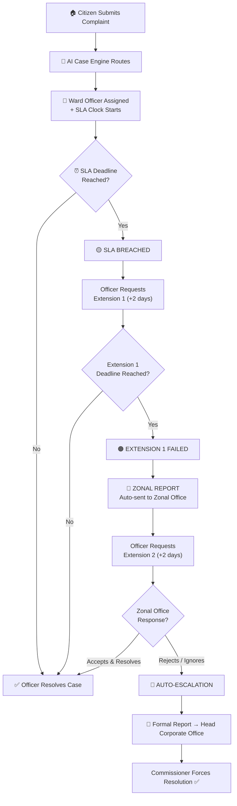
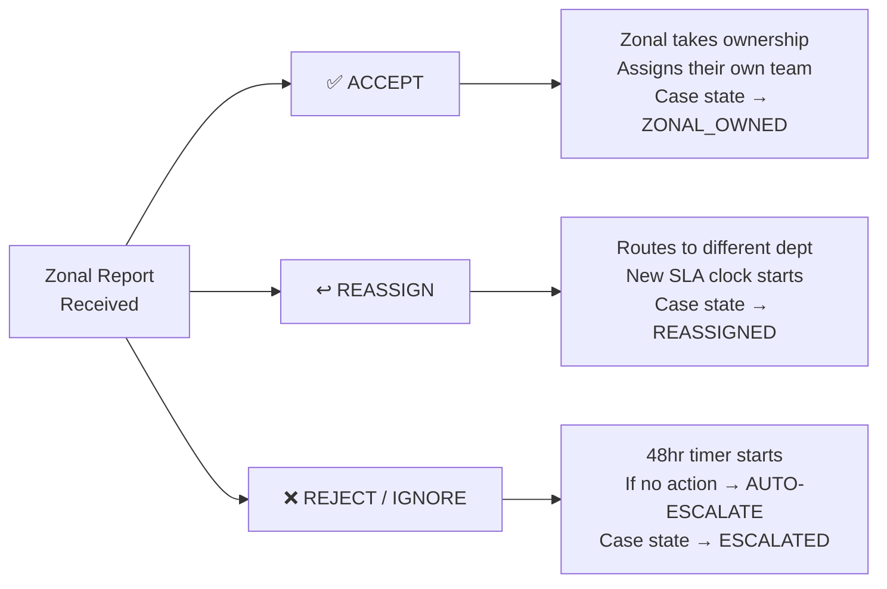
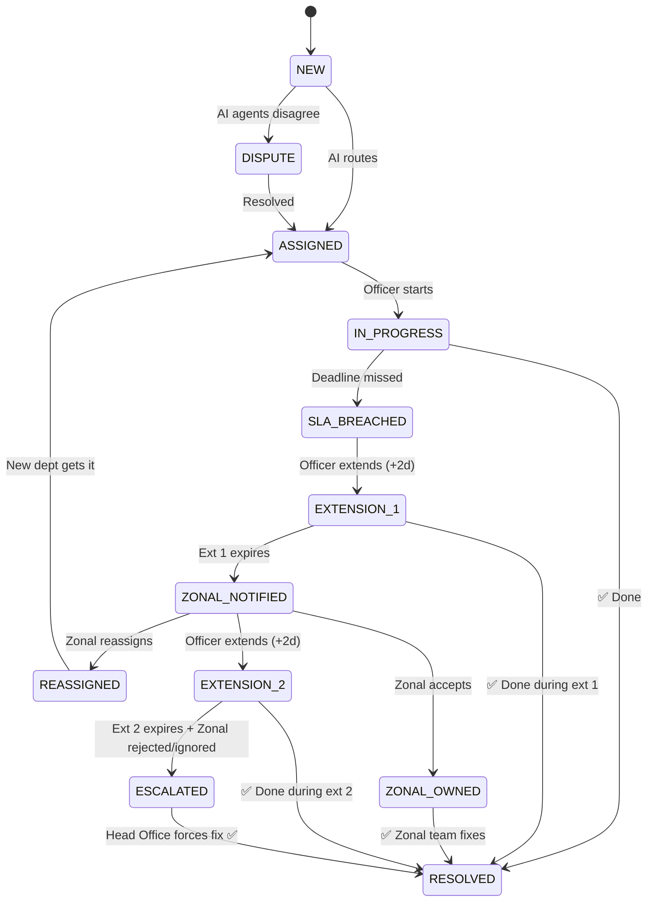

# SLA Escalation Architecture — Complete 3-Tier System

> CivicLoop: Ward Officer → Zonal Office → Head Corporate Office

---

## 1. The Complete Escalation Chain



---

## 2. How Each Tier Works

### TIER 1 — Ward Officer (Ground Level)

| Step | What Happens | Timeline |
|---|---|---|
| Complaint assigned | SLA clock starts (default: 24 hours) | Day 0 |
| SLA breaches | Officer sees amber warning | Day 1 |
| Extension 1 requested | Officer provides a reason, gets +2 days | Day 1 |
| Extension 1 deadline | If still unresolved → auto-escalate to Tier 2 | Day 3 |

**The officer has control.** They can resolve the issue at any point during this phase.

---

### TIER 2 — Zonal Office (Middle Management)

| Step | What Happens | Timeline |
|---|---|---|
| Zonal Report auto-sent | System generates a formal report with all evidence (photos, GPS, extension reason, officer name) and emails it to the Zonal Officer | Day 3 (auto) |
| Zonal Officer notified | Gets email + SMS to their official government contact | Day 3 (auto) |
| Extension 2 granted | Ward officer gets final +2 days, BUT Zonal Office is now watching | Day 3 |
| Zonal Office can respond | **ACCEPT** (take ownership), **REJECT** (not their zone), or **IGNORE** (no response in 48 hrs) | Day 3–5 |
| Extension 2 deadline | If still unresolved AND Zonal rejected/ignored → auto-escalate to Tier 3 | Day 5 |

**The Zonal Office is the accountability checkpoint.** They receive a professional report and must either act or face the consequences of the case going to the Commissioner.

---

### TIER 3 — Head Corporate Office (Top Authority)

| Step | What Happens | Timeline |
|---|---|---|
| Auto-Escalation triggered | Full case file + Zonal Report + Zonal response (or lack of) sent to Commissioner's office | Day 5 (auto) |
| Case marked ESCALATED | Red state across all dashboards | Day 5 (auto) |
| Commissioner's office acts | Either forces the Zonal Office to act, reassigns to a different department, or takes direct action | Day 5+ |

**This is the nuclear option.** No ward officer or zonal officer wants the Commissioner asking why a pothole complaint needed 5 days and 2 extensions.

---

## 3. The Zonal Report (Auto-Generated Document)

When Extension 1 fails, the system automatically generates this report and emails it to the Zonal Office:

```
┌──────────────────────────────────────────────────────────────┐
│                    ZONAL ESCALATION REPORT                    │
│                    Case #C-2026-000123                        │
├──────────────────────────────────────────────────────────────┤
│                                                              │
│  TO:       Zonal Officer — Zone 4 (Perambur)                 │
│  FROM:     CivicLoop Automated System                        │
│  DATE:     October 12, 2026                                  │
│  URGENCY:  HIGH — SLA Extension 1 Exhausted                  │
│                                                              │
├──────────────── COMPLAINT SUMMARY ───────────────────────────┤
│                                                              │
│  Category:     Waterlogging / Civic Issue                    │
│  Subject:      Water standing on road near school            │
│  Description:  "Water has been standing for 3 days and       │
│                 children cannot walk to school safely."       │
│  Ward:         Ward 34                                       │
│  GPS:          13.0827°N, 80.2707°E                          │
│  Photo:        [attached — waterlogging_evidence.jpg]        │
│  Voice Note:   [attached — citizen_voice.mp3]                │
│                                                              │
├──────────────── OFFICER PERFORMANCE ─────────────────────────┤
│                                                              │
│  Assigned To:       AE Ramesh Kumar (Ward 34)                │
│  Original SLA:      Oct 10, 2026 09:00 AM                   │
│  SLA Breached On:   Oct 10, 2026 09:00 AM                   │
│  Extension 1:       +2 days (Oct 12, 2026 09:00 AM)         │
│  Extension Reason:  "Waiting for dewatering pump from        │
│                      central depot"                          │
│  Extension Result:  ❌ UNRESOLVED                            │
│                                                              │
├──────────────── ACTION REQUIRED ─────────────────────────────┤
│                                                              │
│  The ward-level officer has exhausted Extension 1 without    │
│  resolving this complaint. As the Zonal authority, you are   │
│  requested to:                                               │
│                                                              │
│  □ ACCEPT — Take ownership and ensure resolution             │
│  □ REASSIGN — Route to the correct department                │
│  □ ESCALATE — Forward to Head Corporate Office               │
│                                                              │
│  ⚠️ If no response is received within 48 hours, this case   │
│  will be automatically escalated to the Head Corporate       │
│  Office with your non-response on record.                    │
│                                                              │
├──────────────── CITIZEN DETAILS ─────────────────────────────┤
│                                                              │
│  Name:     Anon-481 (Anonymous submission)                   │
│  Channel:  Telegram                                          │
│  Language: Tamil                                             │
│                                                              │
└──────────────────────────────────────────────────────────────┘
```

---

## 4. Zonal Office Response Options

When the Zonal Officer receives the report, they have 3 options:



| Response | What Happens Next | Case State |
|---|---|---|
| **ACCEPT** | Zonal Office takes over. They assign their own team. New internal SLA. | `ZONAL_OWNED` |
| **REASSIGN** | Zonal says "wrong department." Routes to correct dept with fresh SLA. | `REASSIGNED` |
| **REJECT** | Zonal refuses to act. Case sits for 48 hours, then auto-escalates to Head Office. | → `ESCALATED` |
| **IGNORE** (no response in 48hrs) | Same as reject. System treats silence as inaction. Auto-escalates with "Zonal Office: No Response" on record. | → `ESCALATED` |

---

## 5. Updated Data Model

### 5.1 Full SLA Interface

```typescript
interface SLA {
  deadline: string;
  breached: boolean;
  extensions_used: number;          // 0, 1, or 2
  extension_history: ExtensionRecord[];
  
  // Zonal escalation (NEW)
  zonal_report_sent: boolean;       // true after Extension 1 fails
  zonal_report_sent_at: string | null;
  zonal_response: 'pending' | 'accepted' | 'reassigned' | 'rejected' | 'ignored' | null;
  zonal_response_at: string | null;
  zonal_response_note: string | null;
  zonal_deadline: string | null;    // 48hr window for Zonal to respond
  
  // Head Office escalation
  escalated_to_hq: boolean;
  escalated_at: string | null;
  escalation_reason: string | null; // "Zonal rejected" or "Zonal ignored (48hr timeout)"
}

interface ExtensionRecord {
  requested_at: string;
  requested_by: string;
  reason: string;
  old_deadline: string;
  new_deadline: string;
  extension_number: 1 | 2;
}
```

### 5.2 Ward → Zone Mapping Database

```typescript
const WARD_ZONE_MAP: Record<string, ZoneInfo> = {
  "Ward 34": {
    zone: "Zone 4",
    zone_name: "Perambur",
    zonal_officer: "Executive Engineer — Zone 4",
    email: "zo4@chennaicorporation.gov.in",
    phone: "+91-44-25381234",
    office_address: "Zonal Office, Perambur High Road, Chennai-12"
  },
  "Ward 35": {
    zone: "Zone 4",
    zone_name: "Perambur",
    zonal_officer: "Executive Engineer — Zone 4",
    email: "zo4@chennaicorporation.gov.in",
    phone: "+91-44-25381234",
    office_address: "Zonal Office, Perambur High Road, Chennai-12"
  },
  "Ward 36": {
    zone: "Zone 4",
    zone_name: "Perambur",
    zonal_officer: "Executive Engineer — Zone 4",
    email: "zo4@chennaicorporation.gov.in",
    phone: "+91-44-25381234",
    office_address: "Zonal Office, Perambur High Road, Chennai-12"
  }
};

const HEAD_OFFICE = {
  title: "Commissioner, Greater Chennai Corporation",
  email: "commissioner@chennaicorporation.gov.in",
  phone: "+91-44-25619200",
  office: "Ripon Building, Chennai"
};
```

---

## 6. Updated State Machine



---

## 7. Component & File Structure

```
src/
├── app/
│   ├── cases/
│   │   └── [id]/
│   │       └── page.tsx            ← MODIFIED (SLAPanel + Zonal status)
│   ├── zonal/
│   │   ├── page.tsx                ← NEW (Zonal Officer Dashboard)
│   │   └── [id]/
│   │       └── page.tsx            ← NEW (Zonal Report Detail + Response)
│   └── escalations/
│       ├── page.tsx                ← NEW (Head Corporate Office Dashboard)
│       └── [id]/
│           └── page.tsx            ← NEW (Full Escalation Report)
├── components/
│   ├── SLAPanel.tsx                ← MODIFIED (Zonal status added)
│   ├── ZonalReport.tsx             ← NEW (auto-generated report component)
│   └── EscalationReport.tsx        ← NEW (Head Office report component)
├── lib/
│   ├── useCases.ts                 ← MODIFIED (extension + zonal + escalation)
│   ├── mockData.ts                 ← MODIFIED (new SLA fields)
│   ├── slaEngine.ts                ← NEW (all SLA logic)
│   └── wardZoneMap.ts              ← NEW (ward → zone mapping data)
```

---

## 8. UI Wireframes

### 8.1 Officer View — After Extension 1 Fails (Zonal Notified)

```
┌─────────────────────────────────────────────────────────────┐
│  SLA TRACKER                    [ZONAL OFFICE NOTIFIED 🟠]   │
│                                                              │
│              OVERDUE BY                                      │
│              0d 04h 22m 15s                                  │
│              Extension 1 Deadline: Oct 12, 09:00 AM          │
│                                                              │
│  Extensions: 1/2 used                                        │
│  [██████████░░░░░░░░░░]                                      │
│                                                              │
│  ┌────────────────────────────────────────────────────────┐  │
│  │ 📧 ZONAL REPORT SENT                                   │  │
│  │ To: Executive Engineer — Zone 4 (Perambur)             │  │
│  │ Email: zo4@chennaicorporation.gov.in                   │  │
│  │ Sent: Oct 12, 2026 09:01 AM                            │  │
│  │ Status: ⏳ AWAITING RESPONSE (44h remaining)            │  │
│  └────────────────────────────────────────────────────────┘  │
│                                                              │
│  [ 🕐 Request Extension 2 (+2 days) — FINAL ]               │
│  Reason: [_________________________]                         │
│                                                              │
│  ⚠️ Warning: If Extension 2 also fails AND the Zonal        │
│  Office rejects/ignores, this case will be automatically     │
│  reported to the Head Corporate Office.                      │
└─────────────────────────────────────────────────────────────┘
```

### 8.2 Zonal Officer Dashboard (`/zonal`)

```
┌─────────────────────────────────────────────────────────────┐
│  🏛️ ZONAL OFFICE — Zone 4 (Perambur)                        │
│  Cases requiring your attention                              │
├─────────────────────────────────────────────────────────────┤
│                                                              │
│  ┌────────────────────────────────────────────────────────┐  │
│  │ 🟠 #C-2026-000123                                      │  │
│  │ Waterlogging near school — Ward 34                     │  │
│  │ Officer: AE Ramesh Kumar                               │  │
│  │ Extension 1 Reason: "Awaiting dewatering pump"         │  │
│  │ Time to respond: 44h 12m remaining                     │  │
│  │                                                        │  │
│  │  [ ✅ Accept ]  [ ↩️ Reassign ]  [ ❌ Reject ]          │  │
│  │                                     [View Full Report] │  │
│  └────────────────────────────────────────────────────────┘  │
│                                                              │
│  ┌────────────────────────────────────────────────────────┐  │
│  │ 🟠 #C-2026-000456                                      │  │
│  │ Garbage pile at market junction — Ward 35              │  │
│  │ Officer: AE Priya Sharma                               │  │
│  │ Extension 1 Reason: "Festival season, staff shortage"  │  │
│  │ Time to respond: 22h 05m remaining                     │  │
│  │                                                        │  │
│  │  [ ✅ Accept ]  [ ↩️ Reassign ]  [ ❌ Reject ]          │  │
│  │                                     [View Full Report] │  │
│  └────────────────────────────────────────────────────────┘  │
│                                                              │
│  📊 Zone 4 Stats: 2 pending │ 12 resolved this month        │
└─────────────────────────────────────────────────────────────┘
```

### 8.3 Head Corporate Office Dashboard (`/escalations`)

```
┌─────────────────────────────────────────────────────────────┐
│  🔴 HEAD CORPORATE OFFICE — Commissioner Dashboard          │
│  Cases that exhausted all escalation tiers                   │
├─────────────────────────────────────────────────────────────┤
│                                                              │
│  ┌────────────────────────────────────────────────────────┐  │
│  │ ⛔ #C-2026-000789                                       │  │
│  │ Pothole on Anna Nagar 2nd Street — Ward 42             │  │
│  │                                                        │  │
│  │ ESCALATION TRAIL:                                      │  │
│  │ ├─ Ward Officer: AE Suresh — FAILED (2 extensions)     │  │
│  │ ├─ Zonal Office: Zone 4 — REJECTED                     │  │
│  │ │   Reason: "Not in our jurisdiction"                  │  │
│  │ └─ Auto-escalated: Oct 16, 2026                        │  │
│  │                                                        │  │
│  │ Total time unresolved: 6 days                          │  │
│  │                                                        │  │
│  │  [ 📋 View Full Report ]  [ ✅ Force Resolution ]       │  │
│  └────────────────────────────────────────────────────────┘  │
│                                                              │
│  📊 Summary: 1 escalated │ Avg time: 6 days                 │
│  Worst Zone: Zone 4 (2 escalations this month)              │
└─────────────────────────────────────────────────────────────┘
```

---

## 9. Notification Matrix

| Event | Ward Officer | Zonal Office | Head Office | Citizen |
|---|---|---|---|---|
| SLA Breached | 🔔 Alert | — | — | 📱 "Your case is delayed" |
| Extension 1 Requested | ✅ Confirmed | — | — | 📱 "Extended by 2 days" |
| Extension 1 Expired | 🔔 Warning | 📧 **Zonal Report** + 📱 SMS | — | 📱 "Escalated to Zonal Office" |
| Extension 2 Requested | ✅ Confirmed | 📧 "Final extension granted" | — | 📱 "Final 2-day extension" |
| Zonal Accepts | 📧 "Zonal took over" | ✅ Confirmed | — | 📱 "Senior officer assigned" |
| Zonal Rejects | ⚠️ Warning | ✅ Confirmed | — | — |
| Zonal Ignores (48hr) | ⚠️ Warning | ⚠️ "Your silence is on record" | — | — |
| Extension 2 Expired | ⛔ "Case escalated" | ⛔ "Failed case on your record" | 📧 **Full Report** + 📱 SMS | 📱 "Reported to Commissioner" |
| Head Office Resolves | 📧 Notification | 📧 Notification | ✅ Confirmed | 📱 "Your issue is resolved!" |

---

## 10. Complete Timeline — One Case's Journey

```
Day 0 (Mon)    Citizen reports pothole via app
               AI routes to Roads Dept → AE Ramesh assigned
               SLA Clock: 24 hours

Day 1 (Tue)    ⏰ SLA BREACHED
               AE Ramesh clicks "Extension 1"
               Reason: "Heavy rain, cannot patch wet road"
               New deadline: Day 3

Day 3 (Thu)    ⏰ EXTENSION 1 EXPIRED — STILL UNRESOLVED
               📧 ZONAL REPORT auto-generated
               📧 Sent to: Executive Engineer, Zone 4
               📱 SMS: "Urgent: Case #123 breached. Review required."
               ⏳ 48-hour response window starts for Zonal

Day 3 (Thu)    AE Ramesh clicks "Extension 2" (FINAL)
               Reason: "Contractor scheduled for tomorrow"
               New deadline: Day 5

Day 4 (Fri)    Zonal Officer opens report in /zonal dashboard
               Clicks "REJECT" — Reason: "Road is NH, not our jurisdiction"
               📧 Rejection logged on case record

Day 5 (Sat)    ⏰ EXTENSION 2 EXPIRED — STILL UNRESOLVED
               Zonal already rejected ❌
               
               🔴 AUTO-ESCALATION TRIGGERED
               📧 Full Escalation Report → Commissioner's Office
               Report includes:
                 - Original complaint + photos + GPS
                 - AE Ramesh's 2 extension reasons
                 - Zonal Office rejection + their reason
                 - Total time elapsed: 5 days
               
               Case state → ESCALATED
               Appears on /escalations dashboard

Day 6+ (Sun)   Commissioner's office reviews
               Forces Zone 4 to handle it OR reassigns to NH authority
               Case finally resolved ✅
```

---

## 11. Configuration

```typescript
const ESCALATION_CONFIG = {
  // Tier 1 — Ward Officer
  MAX_EXTENSIONS: 2,
  EXTENSION_DURATION_DAYS: 2,
  URGENT_THRESHOLD_HOURS: 6,
  REQUIRE_EXTENSION_REASON: true,

  // Tier 2 — Zonal Office
  ZONAL_REPORT_TRIGGER: "EXTENSION_1_EXPIRED",
  ZONAL_RESPONSE_WINDOW_HOURS: 48,
  ZONAL_RESPONSE_OPTIONS: ["accept", "reassign", "reject"],
  AUTO_ESCALATE_ON_ZONAL_IGNORE: true,

  // Tier 3 — Head Corporate Office
  ESCALATION_TRIGGER: "EXTENSION_2_EXPIRED_AND_ZONAL_REJECTED_OR_IGNORED",
  INCLUDE_ZONAL_RESPONSE_IN_REPORT: true,
  NOTIFY_CITIZEN_ON_ESCALATION: true,

  // Notification Channels
  EMAIL_ENABLED: true,
  SMS_ENABLED: true,
  PUSH_NOTIFICATION_ENABLED: true,
};
```

---

## 12. Implementation Priority

| Priority | Feature | Effort | Files |
|---|---|---|---|
| **P0** | SLA Panel with countdown + extension buttons | ✅ Done | `cases/[id]/page.tsx` |
| **P1** | Zonal Report auto-generation | Medium | `ZonalReport.tsx`, `slaEngine.ts` |
| **P2** | Zonal Officer Dashboard (`/zonal`) | Medium | `zonal/page.tsx` |
| **P3** | Zonal response system (Accept/Reject/Reassign) | Medium | `zonal/[id]/page.tsx` |
| **P4** | Head Office Dashboard (`/escalations`) | Low | `escalations/page.tsx` |
| **P5** | Email/SMS notifications (backend) | High | Backend service needed |
| **P6** | Ward → Zone mapping database | Low | `wardZoneMap.ts` |
